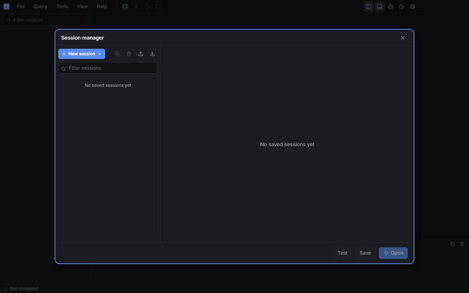

# Open SQL Tools

[](https://github.com/maickonn/Open-SQL-Tools/actions/workflows/ci.yml)

A fast, modern desktop SQL client in the spirit of HeidiSQL, for **MySQL 5.7+**, **MariaDB 10.2+**, **PostgreSQL 15+**, **Firebird 2.5+** and **SQLite** (database files, using the SQLite bundled with Electron), with a built-in AI assistant (Anthropic and OpenAI) that can inspect and query your database. Dark theme by default, light theme available.



This application was written with the help of [Claude Code](https://claude.com/claude-code).

## Features

- **Session manager**: SQLite database files (create if missing, open read-only), folders, colors, SSH tunnels (password, key, agent), SSL/TLS, MariaDB `ed25519`/`parsec` accounts, startup scripts, keep-alive, import/export of sessions. Passwords and API keys are encrypted with the OS keychain (Electron `safeStorage`).
- **Object tree**: databases, schemas, tables, views, materialized views, procedures, functions, packages, triggers, events, sequences/generators, domains, exceptions and types, grouped by kind with counts (like IBExpert), with filtering. Context actions per kind: create from a template, edit, drop, rename, duplicate, empty, maintenance, run a routine, activate/deactivate triggers and events (selected ones or all), and inactive objects are marked in the tree.
- **Object views**: Dependencies tab (objects used by and using the selected one), Operations / plan tab for Firebird procedures and triggers (each DML statement with its execution plan), and editable grids for generators/sequences (current value) and Firebird exceptions (message).
- **Trigger form**: name, table, position, active state, timing and events in fields, with only the body in the editor; the app writes the `CREATE`/`ALTER` for each engine. Saving first shows the statements in a review window and runs nothing until you confirm.
- **Host tab**: process list (kill process or query), server variables, status and command statistics (SQLite: pragmas and compile options).
- **SQL editor** (Monaco): multiple tabs, dialect-aware highlighting, IntelliSense from the live catalog (context-aware completion of tables, columns, aliases, CTEs, schemas, functions and stored routines; hover with column types and keys; signature help for built-in functions and routines; warnings for unknown tables and `alias.column` references while typing), run all / current statement / selection, multiple result sets (editable like the Data tab when they come from one table and include its key; computed columns stay read-only), error markers, EXPLAIN, formatter, query history, snippets, open/save files, transaction control (auto-commit, commit, rollback).
- **Firebird text without a charset** (CHARACTER SET NONE): each value is decoded by its own bytes (UTF-8 or the legacy code page the column uses, detected automatically, also when one column mixes both); edits keep each value's encoding and typed filters such as `WHERE NAME LIKE '%ção%'` match text in every encoding the column holds.
- **Data tab**: canvas-rendered grid (millions of rows), WHERE filter, sorting, paging, inline editing with insert/update/delete posted as SQL, NULL handling, value editor for long text and binary data (Preview, Hex and Text views), copy as TSV/CSV/SQL/Markdown/JSON. Large objects (BLOB, TEXT, bytea) of tables with a key load on demand: the grid shows a preview or the size, and the value is fetched when you open, edit or copy the cell. The value editor recognizes files in BLOBs by their signature (images, PDF, Office documents, archives…), previews images and PDFs, and imports or exports the value from/to a file (also from the cell's context menu, which has no clipboard items for large objects); the grid shows BLOB values as their type, e.g. `(PNG)`, or `(BLOB)` when the type is unknown, and the editor opens them on Hex; images kept in Windows-1252/Latin-1 text BLOBs are restored byte for byte.
- **Table editor**: columns (types picked from the engine's list), indexes, foreign keys, check constraints, table options and partitions (MySQL/MariaDB `PARTITION BY`, PostgreSQL declarative partitions) with a live preview of the generated `CREATE`/`ALTER` SQL. On SQLite, changes `ALTER TABLE` cannot make are applied by rebuilding the table in one transaction, keeping data, indexes, triggers, views and foreign keys.
- **Bulk table editor**: move tables to another database/schema, change engine, collation (optionally converting data), row format, tablespace or owner for many tables at once.
- **Copy table**: to another database, schema or server of the same engine family, with or without data (server-side `INSERT … SELECT` when possible, streamed otherwise).
- **Menus**: File, Query, Tools, View and Help work like a desktop menu bar: once one is open, hovering another switches to it.
- **Keyboard shortcuts**: every action can be rebound in Preferences → Keyboard shortcuts (with conflict detection).
- **Tools**: export grids (CSV, TSV, Excel XLSX, JSON, SQL, HTML, XML, Markdown, LaTeX), SQL dump of databases, run SQL files, CSV import, find text on server, user manager.
- **AI assistant**: streaming chat with tool use. Reads schema and data freely (inside a read-only transaction); any statement that changes data or schema needs your explicit approval. Supported models: Claude Opus 5.5, Claude Sonnet 5.5, Claude Haiku 5.5, GPT 6.1 Sol, GPT 5.6 Terra and GPT 6.0 Luna; new chats start with the last model picked. Each connection keeps its own conversations, so contexts never mix. While the model reasons, the chat shows "Thinking…" without the reasoning text.

## Architecture

Electron + TypeScript, Clean Architecture with MVVM in the renderer.

```
src/
  shared/          IPC contracts, worker RPC, DTOs (no runtime deps)
  domain/          ports (DbConnection, SchemaInspector, SqlDialect, LlmProvider, repositories),
                   SQL splitter/classifier, version capabilities
  application/     session service (runs in the DB worker), agent loop, connections, export/import
  infrastructure/  MySQL/MariaDB (mysql2), PostgreSQL (pg + pg-cursor), Firebird (node-firebird),
                   SQLite (node:sqlite in a child process), app persistence (node:sqlite),
                   safeStorage secrets, Anthropic/OpenAI providers, SSH
  main/            composition root, window, IPC handlers, session manager
  preload/         typed contextBridge API
  renderer/        React views + Zustand view models
```

Performance design:

- Every database session runs in its own Electron **utility process**; drivers never block the UI or the main process.
- Results stream from the worker straight to the renderer over a dedicated `MessagePort` as **columnar chunks**; the grid reads cells on demand and never copies rows into React state.
- Each session keeps a second connection for catalog browsing, kills and AI reads, so a long query never freezes the object tree.
- Monaco, the AI chat and the tool dialogs load lazily.
- Catalog queries are combined into as few round trips as possible, which matters over SSH tunnels and WAN links.
- SQLite connections run in their own child process, so a long statement can be cancelled by stopping that process.

Settings, saved sessions, query history and chats live in the app's profile folder (`%APPDATA%\Open SQL Tools` on Windows, `~/Library/Application Support/Open SQL Tools` on macOS, `~/.config/Open SQL Tools` on Linux).

## Development

Requirements: Node.js 22.12+ and Docker (for the server test databases; SQLite tests need no container).

```bash
npm install
npm run dev
```

Other scripts:

| Script | What it does |
| --- | --- |
| `npm run typecheck` | Type-checks main/preload/worker and renderer |
| `npm test` | Unit tests |
| `npm run test:db -- mysql97 postgres18` | Starts only those database containers, runs the integration tests against them, then stops them |
| `DB_TARGETS=sqlite npx vitest run --project integration` | Integration tests for SQLite (temporary files, no container) |
| `npm run db:up -- mariadb118` / `npm run db:stop -- mariadb118` | Start/stop a single test server |
| `npm run test:e2e:db -- postgres18 firebird5` | Builds the app and runs the Playwright flow (connect, create, edit, copy, bulk/partition editors) against only those containers |
| `npm run build && OST_E2E_TARGETS=sqlite npx playwright test tests/e2e/engines.spec.ts` | The same flow for SQLite (no container) |
| `npm run test:e2e` | Builds and drives the real Electron app with Playwright (set `OST_E2E_MYSQL_PORT=33097` with `mysql97` running for the connected scenario) |
| `npm run package` | Builds installers with electron-builder |
| `npm run demo` | Builds the app and records `docs/demo.gif` from a scripted storyboard (`scripts/demo`, needs `ffmpeg` on the PATH; the AI scene uses a scripted provider, `OST_DEMO_AI=1`) |
| `OST_SPLASH_PREVIEW=update npm run dev` | Shows the startup update splash with a fake release (`offline` and `latest` show the other outcomes) |

### Test databases

`docker/compose.yml` defines one service per supported server version, with no volumes (each start is clean). Start only what you are testing; running the whole matrix at once is too heavy for Docker Desktop.

| Engine | Services (host port) |
| --- | --- |
| Firebird | `firebird25` (30250, built from the official 2.5.9 tarball), `firebird3` (30300), `firebird4` (30400), `firebird5` (30500), `firebird6` (30600, snapshot, `preview` profile) |
| MySQL | `mysql57` (33057), `mysql80` (33080), `mysql84` (33084), `mysql97` (33097), `mysql267` (33267) |
| MariaDB | `mariadb102` … `mariadb130` (34102 … 34130) |
| PostgreSQL | `postgres15` … `postgres18` (35415 … 35418), `postgres19` (35419, RC, `preview` profile) |

The `tools` profile adds `sshd` (port 2222, user/password `tunnel`, throwaway key `docker/sshd/test_key`; reach databases by service name, e.g. `mysql97:3306`) and `postgres18ssl` (port 35428, TLS on).

Credentials: MySQL/MariaDB `root`/`test`, PostgreSQL `postgres`/`test`, Firebird `SYSDBA`/`masterkey`. Each server has a `testdb` database (Firebird: `/var/lib/firebird/data/testdb.fdb`).

## CI and releases

GitHub Actions ([`ci.yml`](.github/workflows/ci.yml)) runs on every push to `main` and every pull request: typecheck, unit tests and build, then one job per database server in `docker/compose.yml` (integration tests, plus the Electron end-to-end flow for SQLite, `firebird5`, `mysql97`, `mariadb118` and `postgres18`), the SSH/TLS connectivity tests and a Windows installer build.

To release, write the user-facing changes under `## [Unreleased]` in [`CHANGELOG.md`](CHANGELOG.md), rename that heading to the new version (e.g. `## [0.1.1]`) and commit, then bump the version and push the tag:

```bash
npm version patch
```

```bash
git push --follow-tags
```

[`release.yml`](.github/workflows/release.yml) checks that the tag matches `package.json`, creates a draft GitHub release with that version's `CHANGELOG.md` section as its notes (it fails if the section is missing) and uploads the Windows installer and its update feed (`latest.yml`). Test the installer, then publish the draft.

Installed Windows builds check the published releases on startup (a small splash: update available with the first changelog items, download progress, restart to install) and open normally when offline or up to date; the check can be turned off in Preferences. Linux and macOS builds are not published yet.

## License

[MIT](LICENSE). The packaged app ships `THIRD_PARTY_NOTICES.txt`, generated at build time with the licenses of every bundled or installed dependency, next to Electron's `LICENSE.electron.txt` and `LICENSES.chromium.html`.
